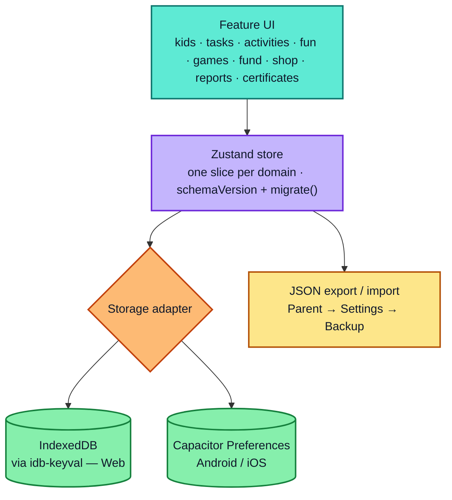
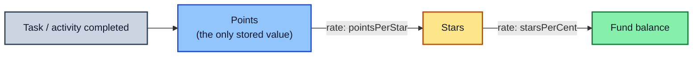

<p align="center">
  
</p>

**Do tasks. Have fun. Grow your fund.**

TaskFunFund teaches kids responsibility in small daily steps. Kids do their own jobs and
learning activities to earn points; fun options sit right alongside tasks, never locked
behind them; and every point quietly grows into stars, then real money, in the kid's own
fund. Parents set up tasks, fun, rates and rewards per child; kids pick what to do through
mini-games, tick things off, and watch their fund grow; parents review weekly reports,
print certificates and approve rewards.

Tone throughout: warm and encouraging, never shaming. Missing a task just means not
earning — nothing is ever taken away.

## Architecture

### App & data layers



Everything is local-first — there's no server or account — so the storage adapter is the only
place that knows whether it's running on web or native.

### Points → stars → money



Stars and money are never persisted — they're recalculated from points and the current rates
every time a screen renders, so a parent changing a rate later never rewrites history.

## Running it

### Web

```bash
npm install
npm run dev        # local dev server with HMR
npm run build       # production build to dist/
npm run preview     # preview the production build
```

The production build is also an installable PWA (offline-capable, add-to-home-screen).

### Android

Requires [Android Studio](https://developer.android.com/studio).

```bash
npm run build
npx cap sync android
npx cap open android   # opens the project in Android Studio — Run ▶ from there
```

### iOS

Requires a Mac with [Xcode](https://developer.apple.com/xcode/) and CocoaPods.

```bash
npm run build
npx cap sync ios
npx cap open ios        # opens the project in Xcode — Run ▶ from there
```

(The `ios/` project folder is already generated and committed, but Xcode itself is only
available on macOS — this repo was built on Windows, so iOS could not be run or verified
here. Android was verified with `npx cap doctor`.)

### Tests, lint, type-check

```bash
npm run test     # Vitest + React Testing Library
npm run lint      # oxlint
npm run build     # tsc -b && vite build (type-checks as part of the build)
```

## Data & backup

Everything lives entirely on-device — there is no server or account. On the web it's
IndexedDB (via `idb-keyval`); in the native apps it's Capacitor Preferences. Either way
it's one versioned, persisted Zustand store (`src/store/useStore.ts`), with a
`schemaVersion` and a `migrate()` step so future updates never wipe existing data.

Parents can export everything to a JSON file (Parent → Settings → Export backup) and
restore it later or on a new device (Import backup). Nothing is ever uploaded anywhere.

## Points, stars, money & weeks

Kids only ever earn **points** — for tasks, activities, and streak/all-done bonuses.
Stars and money are never stored; they're always calculated from points on the fly, using
rates the parent sets (default: **5 points = 1 star**, **5 stars = 1 cent**). That means
changing a rate later never corrupts history — it just changes how future points convert.
Leftover points always carry toward the next star (13 points reads as "2 ⭐ + 3 toward the
next star").

Every earned/spent record carries a `weekKey` computed from its date (`src/lib/dates.ts`),
so a new week's reports start fresh automatically — there's no cron job or cleanup step,
and old weeks stay exactly as they were for the Overall report.

## Folder overview

```
src/
  app/          routing, the app shell (bottom tabs / side rail), providers
  store/        Zustand slices (one per data domain) + the storage adapter
  features/     one folder per feature area — kids, tasks, activities, fun,
                games (the 4 pick games), fund, shop, screentime, reports,
                certificates, parent (PIN, settings, approvals)
  components/   shared UI — Button, Card, Modal, PointBadge, KidSwitcher...
  lib/          pure, unit-tested logic — dates, fund math, pick pool,
                streaks, reports, screen-time timers, sounds, PDF export
  test/         shared test helpers
assets/         source files for the app logo, icon and splash (regenerate with
                `npx @capacitor/assets generate`)
android/, ios/  native Capacitor projects
```

Every exported function, hook and component carries a one-line JSDoc comment explaining
what it does, not how.
